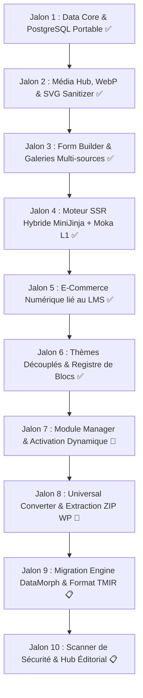

# ⚡ FEUILLE DE ROUTE OFFICIELLE & ARCHITECTURE — RUSTFORGE CMS (2026-2027)

> **RustForge CMS 2027** est un CMS AI-native de nouvelle génération entièrement codé en **Rust** (Axum 0.8, Tokio, PostgreSQL 18, MiniJinja 3, Moka L1 Cache, Wasmtime), guidé par une philosophie tripartite : *moderniser sans perdre l'existant, simplifier sans limiter les possibilités, et automatiser sans retirer le contrôle à l'utilisateur* (voir [PITCH_RUSTFORGE_2027.md](file:///c:/Users/cleme/Desktop/CMS%20Rust/docs/PITCH_RUSTFORGE_2027.md) et la matrice de transition [PLAN_DE_TRANSITION_RUSTFORGE.md](file:///c:/Users/cleme/Desktop/CMS%20Rust/docs/PLAN_DE_TRANSITION_RUSTFORGE.md)).

---

## 🏛️ PARTIE 1 : ARCHITECTURE DU RENDU HTML (SSR HYBRIDE)

RustForge CMS résout le compromis historique entre **vitesse brute de chargement** et **flexibilité des thèmes dynamiques** :

### Architecture Déployée : `Axum 0.8 + MiniJinja 3 + Moka (Cache L1)`

```text
                                  REQUÊTE VISITEUR
                                         │
                                         ▼
                            ┌────────────────────────┐
                            │      AXUM + TOKIO      │
                            └───────────┬────────────┘
                                        │
                       ┌────────────────┴────────────────┐
                       ▼                                 ▼
             SITE PUBLIC (HTML)                  API HEADLESS (JSON)
                       │                                 │
                       ▼                                 ▼
         ┌───────────────────────────┐           Studio Admin React 19
         │   CACHE L1 MÉMOIRE (MOKA) │           ou Clients API Tiers
         └─────────────┬─────────────┘
                       │
             ┌─────────┴─────────┐
             ▼                   ▼
         CACHE HIT           CACHE MISS
       (0.36 à 0.48 ms)          │
                                 ▼
                     ┌───────────────────────┐
                     │   MOTEUR SSR HYBRIDE  │
                     └───────────┬───────────┘
                                 │
                 ┌───────────────┴───────────────┐
                 ▼                               ▼
       MINIJINJA 3 (THÈMES DYNAMIQUES)    MODE ZEN / SANS DISTRACTION
       • Templates éditables à chaud      • Vue épurée optimisée lecture
       • Injection des tokens de design   • Choix typographique & thèmes
       • Multilingue (/fr, /en, hreflang) • Zéro script lourd
                 │                               │
                 └───────────────┬───────────────┘
                                 │
                                 ▼
                     PRÉ-RENDU & POPULATION MOKA
                                 │
                                 ▼
                         RÉPONSE HTML FINALE
```

---

## 🧭 PARTIE 2 : AVANCEMENT & FEUILLE DE ROUTE OPÉRATIONNELLE



---

### 🟢 JALON 1 — Données & Schéma de Base (Terminé ✅)
- [x] Déploiement de PostgreSQL portable dans `.pgsql/` (autonome sans droits d'administration Windows).
- [x] Application des migrations initiales `01_initial.sql` et `02_native_suite.sql`.
- [x] Modèles du domaine : `User`, `Role` (Argon2id), `Entry`, `ContentType`, `Term`.

### 🟢 JALON 2 — Moteur Média & Conversion WebP Rust (Terminé ✅)
- [x] Pipeline asynchrone Rust `media_processor.rs` avec compression WebP native (qualité 82%).
- [x] Assainissement XML/SVG strict (`quick-xml`) contre les attaques XSS et injections XXE.
- [x] Organisation des médias en dossiers et sous-dossiers virtuels hiérarchiques (`media_folders`).

### 🟢 JALON 3 — Formulaires Pro & Galeries Multi-sources (Terminé ✅)
- [x] Moteur `forms.rs` : validation de schéma JSON, honeypot anti-spam, hachage IP anonymisé RGPD (SHA-256 avec sel tournant).
- [x] Moteur `galleries.rs` : albums d'images locales, vidéos MP4 et intégrations YouTube/Vimeo.
- [x] Intégration IA locale `gemma4:12b` via Ollama avec Tool Calling déterministe validé.

### 🟢 JALON 4 — Moteur SSR Hybride (MiniJinja 3 + Cache Moka L1) (Terminé ✅)
- [x] Moteur de rendu MiniJinja couplé au cache L1 en mémoire vive Moka.
- [x] Routage multilingue direct (`/`, `/{locale}`, `/{locale}/{type}/{slug}`) et balises `hreflang`.
- [x] Performances mesurées : **0,36 ms à 0,48 ms** en cache HIT.
- [x] Mode lecture sans distraction (**Mode Zen**) avec sélecteur de typographie et thèmes de lecture.

### 🟢 JALON 5 — E-Commerce Dématérialisé Lié au LMS (Terminé ✅)
- [x] Migration SQL `03_ecommerce.sql` appliquée : produits, commandes, réductions, liaisons cours.
- [x] Services Rust `ecommerce.rs` & `lms.rs` avec typage fort des énumérations SQLx (`product_status`, `discount_type`, `order_status`).
- [x] Génération de jetons de téléchargement signés cryptographiquement (**HMAC-SHA256**) avec quotas stricts.
- [x] **Liaison LMS atomique** : inscription automatique de l'acheteur dans `lms_enrollments` validée en direct.

### 🟢 JALON 6 — Thèmes Découplés & Registre Universel de Blocs (Terminé ✅)
- [x] **Dossier de Thèmes Autonome** :
  - Création de `themes/default/` avec `theme.json` (design tokens CSS) et `templates/` MiniJinja éditables à chaud sans recompiler.
  - Découplage complet des templates hors du crate `trustpress-api`.
- [x] **Registre Universel de Blocs (`trustpress-core::blocks`)** :
  - Spécification des blocs fondamentaux : `paragraph`, `heading`, `image`, `quote`, `code`, `callout`, `columns`, `button`, `faq`, `form_embed`, `course_card`, `product_card`.
  - Moteur de rendu HTML universel de blocs testé avec succès (9 tests unitaires passés).

---

### 🟢 JALON 7 — Module Manager & Activation Dynamique (Opérationnel ✅)
- [x] Fonctions de base dans `settings.rs` (`get_active_modules`, `is_module_active`).
- [x] Routes API REST `/api/v1/settings` et `/api/v1/converter/apply-plan`.
- [x] Activation/désactivation dynamique en base de données PostgreSQL.
- [x] Contrôle dynamique dans le Studio React 19.

### 🟢 JALON 8 — Universal Converter, Capability Intelligence & REA (Opérationnel ✅)
- [x] **Spécifications d'Ingénierie Validées** :
  - [UNIVERSAL_CONVERTER_SPEC.md](file:///c:/Users/cleme/Desktop/CMS%20Rust/docs/UNIVERSAL_CONVERTER_SPEC.md) (10 livrables, 4 stratégies).
  - [CAPABILITY_INTELLIGENCE_SPEC.md](file:///c:/Users/cleme/Desktop/CMS%20Rust/docs/CAPABILITY_INTELLIGENCE_SPEC.md) (Contrats réels, Graphe fonctionnel, Gap Analysis, Composer déclaratif, Micro-Plugin Builder WASM, Community Registry).
  - [REA_INTEGRATION_SPEC.md](file:///c:/Users/cleme/Desktop/CMS%20Rust/docs/REA_INTEGRATION_SPEC.md) (Audit REA `morluto/rea`, contrat `AnalysisProvider` multi-niveaux 1 à 4, benchmark 3 cas, modèle sécurité).
- [x] **Service d'Ingestion Sécurisé ZIP** :
  - Quotas anti zip-bomb (max 250 Mo décompressé, 2000 fichiers), rejet strict du Directory Traversal (`../`).
- [x] **Classificateur Déterministe & Analyseur Lexical** :
  - Détection instantanée Thème FSE, Thème classique ou Plugin sans exécution de code PHP.
  - Extraction des hooks (`add_action`, `add_filter`), shortcodes, post types et métadonnées.
- [x] **Capability Registry & Matcher** :
  - Mappage des fonctionnalités vers les modules natifs `forms`, `ecommerce`, `lms`, `media`, `galleries`.
- [x] **Prototype Cas A (Thème FSE Twenty Twenty-Five)** :
  - Transmutation déclarative des design tokens vers `theme.json` TrustPress et des templates Gutenberg vers MiniJinja 3.
  - Tests unitaires validés (100% de réussite).
- [x] **Prototype Cas B (Plugin Formulaires WPForms Lite)** :
  - Détection des capacités, neutralisation du code PHP/jQuery, substitution par le module natif Forms et plan DataMorph.
  - Tests unitaires validés (100% de réussite).
- [x] **Interface Studio React 19 (Glisser-Déposer)** :
  - Vue `ConverterView.tsx` accessible en 1 clic dans la Sidebar avec diagnostic en 5 étapes.
  - Transmutation en direct, prévisualisation miroir et validation avant activation.

---

### 🚀 JALON 9 — Moteur de Migration DataMorph & Format TMIR
- [x] **Décodeur PHP Sérialisé Rust** :
  - Traduction récursive des primitives, tableaux indexés et associatifs PHP `a:5:{...}` en arbres JSONB PostgreSQL (`php_serializer.rs`).
- [x] **Format Pivot TMIR (TrustPress Migration Intermediate Representation)** :
  - Schéma JSON strict et versionné (`TMIRDocument`, `TMIREntry`, `TMIRTerm`, `TMIRMedia`, `TMIRImportReport`).
- [x] **Le Coffre-Fort (`_legacy_vault`)** :
  - Préservation intégrale des données métadonnées dans `entries.fields['_legacy_vault']` (garantie zéro perte brute).
- [x] **Connecteur WordPress WXR & Ingestion Streaming** :
  - Ingestion streaming XML via `quick-xml`, injection directe en base PostgreSQL dans `entries`, `taxonomies`, `terms`, `entry_terms`.
  - Commande CLI `trustpress import-wxr --file <path>` et endpoint API `POST /api/v1/converter/import-wxr`.
  - Onglet Studio DataMorph glisser-déposer dans `ConverterView.tsx` avec tableau de bord métrique temps réel.

---

### 🚀 JALON 10 — Scanner de Sécurité & Hub Éditorial (Kanban & Planificateur)
- [x] **Scanner de Vulnérabilités & Compatibilité (CLI & Web)** :
  - Audit instantané des risques de runtime PHP2Shell et projection d'accélération sub-milliseconde (`trustpress scan-wp <cible>`).
- [x] **Hub Éditorial (PublishPress-Style)** :
  - Tableau Kanban interactif avec basculement 1-clic depuis la vue liste et drag & drop des articles (*Brouillons*, *Publiés*, *Archivés*) dans `EntriesView.tsx`.
  - Dépublication automatique programmée à la minute près (`scheduled_unpublish_at`) dans `EntryEditorView.tsx`.
  - Planificateur souverain en tâche de fond Tokio (`crates/trustpress-core/src/scheduler.rs`), actif dès le démarrage de `trustpress serve`.

---

### 🛡️ JALON 11 — Intégrité Fondamentale & Audit Fixes (Priorité 1 Validée)
- [x] **Garantie Zéro Perte de Données & Coffre-Fort (`merge_fields`)** :
  - Fusion récursive intelligente des champs dans `entries::update` : le coffre-fort `_legacy_vault` (postmeta, ACF, shortcodes) n'est jamais écrasé lors d'une édition.
  - Badge visuel en temps réel dans le Studio (`EntryEditorView.tsx`) indiquant les clés préservées du coffre-fort.
- [x] **Préservation des Taxonomies et Termes (`term_ids: Option<Vec<Uuid>>`)** :
  - Les catégories et étiquettes ne sont plus effacées lors d'une mise à jour partielle ou sauvegarde de contenu.
- [x] **Correction du cycle de re-publication automatique des brouillons (`scheduler.rs` & `entries.rs`)** :
  - Lors de la remise en brouillon d'un article publié, `published_at` est remis à `None` (sauf planification future explicite), empêchant le planificateur de le republier à tort.
- [x] **Ingestion Réelle des Médias dans DataMorph (`importer.rs` & `wxr_importer.rs`)** :
  - Les pièces jointes WXR sont insérées dans la table `media` avec leur chemin d'origine, types MIME et textes alternatifs.
  - Résolution dynamique de l'image mise en avant (`featured_media_id`) via `_thumbnail_id` sur les entrées importées.
- [x] **Scanner CLI Dynamique & Temps Réel (`WordPressScanner` & `trustpress scan-wp <cible>`)** :
  - Inspection réelle de `wp-includes/version.php`, parsing des en-têtes standard de plugins dans `wp-content/plugins/`, détection FSE `theme.json`.
  - Mappage en temps réel avec le `CapabilityRegistry` et calcul du taux de couverture natif (testé sur 16 plugins avec 68.8% de remplacement natif immédiat).
- [x] **Sécurisation du Tunnel E-Commerce (`ecommerce.rs`)** :
  - Les commandes payantes sont initialisées au statut `pending` ; les jetons de téléchargement HMAC-SHA256 et inscriptions LMS ne sont délivrés qu'après validation du paiement (`complete_order`).

---

### 🚀 JALON 12 — Transition Souveraine RustForge CMS & Standard `rf` (En Cours)
- [x] **Plan Directeur & Matrice de Transmutation `wp` ➔ `rf`** :
  - Document de référence établi dans [docs/PLAN_DE_TRANSITION_RUSTFORGE.md](file:///c:/Users/cleme/Desktop/CMS%20Rust/docs/PLAN_DE_TRANSITION_RUSTFORGE.md).
  - Établissement de la règle d'or : absorption tolérante en entrée (legacy), normalisation souveraine en base (`rf_*`), émission stricte en sortie (`rf:*`).
- [ ] **Étape A — Normalisation des Champs et du Coffre-Fort (`_rf_vault` & `rf_*`)** :
  - Migration de `wp_categories` / `wp_tags` vers `rf_categories` / `rf_tags`.
  - Transition du coffre-fort vers `_rf_vault` avec badge Studio `🔒 Coffre-fort RF`.
- [ ] **Étape B — Évolution du Format Pivot vers RFIR (RustForge Intermediate Representation)** :
  - Normalisation de TMIR vers RFIR avec compatibilité ascendante.
- [ ] **Étape C — Normalisation des Blocs et Sérialisation `rf:`** :
  - Émission de balises de blocs souveraines `<!-- rf:heading -->`, `<!-- rf:paragraph -->`.
- [ ] **Étape D — Rebranding de l'Interface Studio (RustForge Studio)** :
  - Élimination de toute mention de WordPress dans l'application React 19 au profit d'intitulés d'ingestion universels.
- [ ] **Étape E — Rebranding du Binaire CLI (`rustforge`)** :
  - Renommage des commandes en `rustforge scan-legacy` et `rustforge import-content`.

---

### 🧹 Nettoyage & Clôture Technique
- [ ] **Suppression programmée de l'archive d'échantillons (`_legacy_samples_archive/`)** :
  - Les dossiers de référence (`plugins-ref`, `theme-ref`, `wordpress`) ont été consolidés et isolés dans `_legacy_samples_archive/` (exclus de Git).
  - Ce dossier est conservé temporairement comme banc d'essai local pour tester le glisser-déposer dans le Studio et les scans CLI, et a vocation à être supprimé définitivement à terme.


