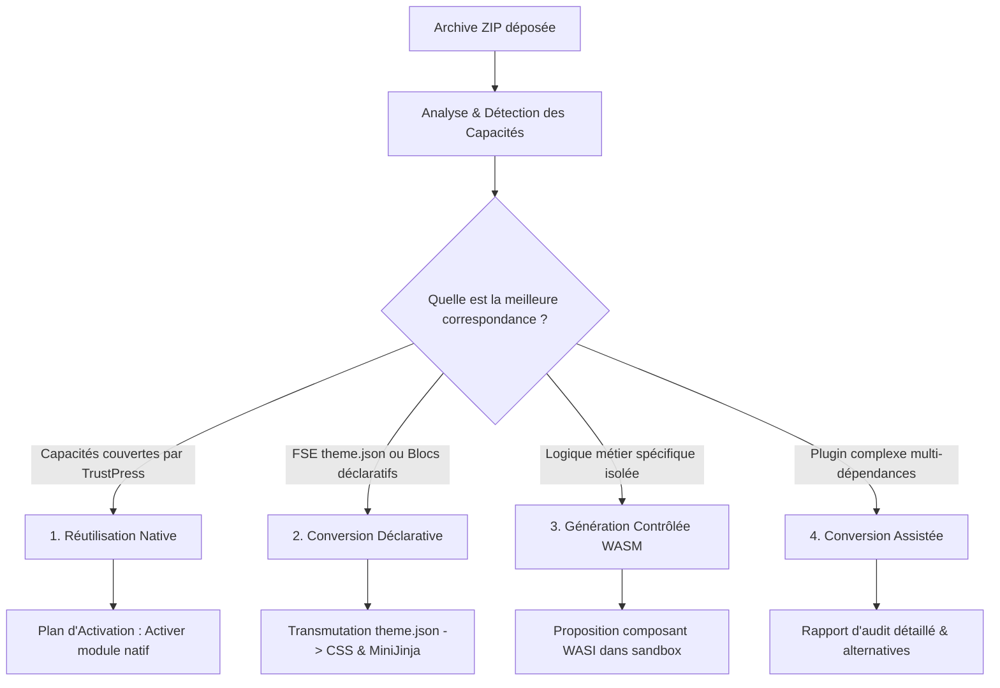

# 🔄 TRUSTPRESS UNIVERSAL CONVERTER — SPÉCIFICATION TECHNIQUE & ARCHITECTURE
## Moteur de conversion universel de thèmes et plugins WordPress vers TrustPress sans runtime PHP

**Date :** 27 octobre 2026  
**Projet :** TrustPress  
**Localisation :** `crates/trustpress-core/src/converter/` & `admin/src/components/ConverterView.tsx`  
**Statut :** Spécification d'ingénierie, architecture de référence & Implémentation validée  

---

## 🌟 1. AUDIT DES COMPOSANTS TRUSTPRESS EXISTANTS

Pour éviter toute duplication de code et garantir une cohérence maximale avec le socle existant, le convertisseur s'articule directement sur les moteurs déjà développés :

```text
┌─────────────────────────────────────────────────────────────────────────────┐
│                      MATRICE D'INTÉGRATION DU CONVERTISSEUR                 │
├──────────────────────────┬─────────────────────────┬────────────────────────┤
│ Composant Existant       │ Crate / Module          │ Rôle pour le Converter │
├──────────────────────────┼─────────────────────────┼────────────────────────┤
│ Capability Registry      │ trustpress-core         │ Catalogue universel des│
│                          │                         │ capacités & modules    │
│ Module Manager           │ trustpress-core::setting│ Activation dynamique   │
│                          │                         │ des modules cibles     │
│ Universal Block Registry │ trustpress-core::blocks │ Conversion AST blocs   │
│                          │                         │ Gutenberg -> TP Blocks │
│ SSR Render Engine        │ trustpress-api::ssr     │ MiniJinja 3 + Moka L1  │
│                          │                         │ & templates de thèmes  │
│ Theme Token System       │ themes/<theme>/theme.jso│ Transposition design   │
│                          │                         │ tokens FSE -> TP CSS   │
│ Media Hub & WebP         │ trustpress-core::media  │ Ingestion & conversion │
│                          │                         │ WebP des assets        │
│ Native E-Commerce & LMS  │ trustpress-core::ecom/lm│ Cibles directes pour   │
│                          │                         │ EDD/Woo/Sensei         │
│ Native Form Builder      │ trustpress-core::forms  │ Cibles directes pour   │
│                          │                         │ WPForms / Contact Form │
│ WASM Sandbox Runtime     │ trustpress-plugins      │ Hôte pour adaptateurs  │
│                          │ (Wasmtime WASIp2)       │ générés isolés         │
└──────────────────────────┴─────────────────────────┴────────────────────────┘
```

### Principes directeurs de non-duplication :
1. **Pas de transpileur universel PHP ➔ Rust :** Aucun interpréteur PHP n'est introduit dans le moteur de publication TrustPress. La priorité est la compréhension sémantique des capacités du plugin et la réutilisation des modules natifs déjà écrits en Rust.
2. **Le Capability Registry est la source de vérité :** Le convertisseur ne réinvente pas ce que le CMS sait faire. Il interroge le `CapabilityRegistry` pour déterminer si une capacité (ex: `forms.submission`, `commerce.digital_downloads`) est couverte nativement.
3. **Le Module Manager applique les activations :** Le convertisseur produit un `ActivationPlan` déclaratif. C'est le `ModuleManager` existant (`settings.modules.active`) qui applique l'activation effective après validation de l'administrateur.
4. **Le Render Engine (MiniJinja 3) reçoit les templates :** La conversion des templates FSE HTML produit des fichiers `.html` MiniJinja placés dans `themes/<theme_slug>/templates/`, immédiatement compatibles avec le rechargement à chaud.

---

## 🏗️ 2. ARCHITECTURE DU CONVERTISSEUR

Le convertisseur est structuré comme un pipeline modulaire sécurisé en 8 étapes :

```text
                       ARCHIVE ZIP DÉPOSÉE (Studio React 19)
                                       │
                                       ▼
                  ┌─────────────────────────────────────────┐
                  │ 1. SERVICE D'IMPORT SÉCURISÉ            │
                  │ • Validation MIME & Magic Bytes (PK\x03) │
                  │ • Quotas décompression (Anti Zip-Bomb)  │
                  │ • Sandbox temporaire en mémoire/disque  │
                  └────────────────────┬────────────────────┘
                                       │
                                       ▼
                  ┌─────────────────────────────────────────┐
                  │ 2. CLASSIFICATEUR DE PACKAGE            │
                  │ • Thème FSE (theme.json + templates/)   │
                  │ • Thème Classique (style.css + index.php)│
                  │ • Plugin WordPress (en-têtes PHP standard│
                  └────────────────────┬────────────────────┘
                                       │
                    ┌──────────────────┴──────────────────┐
                    ▼                                     ▼
        ┌───────────────────────┐             ┌───────────────────────┐
        │ 3A. ANALYSEUR THÈMES  │             │ 3B. ANALYSEUR PHP     │
        │ • Extraction theme.json│            │ • Parser AST PHP      │
        │ • Tokens (color, font)│             │ • Extraction Hooks    │
        │ • Patterns de blocs   │             │   (actions, filters)  │
        │ • Templates HTML FSE  │             │ • Custom Post Types   │
        └───────────┬───────────┘             │ • Shortcodes & Tables │
                    │                         └───────────┬───────────┘
                    └──────────────────┬──────────────────┘
                                       │
                                       ▼
                  ┌─────────────────────────────────────────┐
                  │ 4. MOTEUR DE RÉSOLUTION DES MODULES     │
                  │ & CAPABILITY REGISTRY                   │
                  │ • Mapping WP Hooks -> TP Capabilities   │
                  │ • Identification des modules cibles     │
                  │ • Stratégies 1 à 4 (Native, Décl, etc.) │
                  └────────────────────┬────────────────────┘
                                       │
                                       ▼
                  ┌─────────────────────────────────────────┐
                  │ 5. FORMAT INTERMÉDIAIRE VERSIONNÉ       │
                  │ • Manifeste de Conversion (TPMv1)       │
                  │ • Inventaire complet, score compatibilité│
                  │ • Plan d'activation non exécuté         │
                  └────────────────────┬────────────────────┘
                                       │
                                       ▼
                  ┌─────────────────────────────────────────┐
                  │ 6. CONVERTISSEUR DÉCLARATIF             │
                  │ • FSE theme.json -> TrustPress theme.json│
                  │ • Gutenberg HTML -> MiniJinja 3 HTML    │
                  │ • Form fields schema -> JSON Schema TP  │
                  └────────────────────┬────────────────────┘
                                       │
                                       ▼
                  ┌─────────────────────────────────────────┐
                  │ 7. MOTEUR DE VALIDATION & SÉCURITÉ      │
                  │ • Vérification syntaxe templates        │
                  │ • Scan zéro-PHP & assainissement XSS    │
                  │ • Génération rapport de compatibilité   │
                  └────────────────────┬────────────────────┘
                                       │
                                       ▼
                  ┌─────────────────────────────────────────┐
                  │ 8. PRÉVISUALISATION & PACKAGING         │
                  │ • Rendu miroir de test (< 1 ms)         │
                  │ • Enregistrement dans Catalogue Recettes│
                  │ • Validation utilisateur avant commit   │
                  └─────────────────────────────────────────┘
```

---

## 📦 3. CHOIX DES PARSEURS & DÉPENDANCES RUST

Pour assurer vélocité, robustesse et sécurité mémoire, les composants suivants sont retenus :

1. **Extraction d'Archives : `zip` (version 2.2+)**
   - Rôle : Lecture en streaming sans décompresser aveuglément sur disque.
   - Contrôle strict de taille par fichier (max 50 Mo par fichier unitaire, max 250 Mo décompressé au total) et ratio de compression (< 1:100) pour neutraliser les attaques *Zip-Bomb*.
2. **Analyse de Thèmes FSE : `serde_json`**
   - Rôle : Décodage rapide et tolérant du fichier `theme.json` de WordPress FSE.
   - Mappage des structures `settings.color.palette`, `settings.typography.fontFamilies`, `settings.spacing.spacingScale` vers les tokens CSS de TrustPress.
3. **Analyse Statique PHP : Analyseur Déterministe Regex / Lexer Rust**
   - Rôle : Extraction des métadonnées standard de plugins WordPress (`Plugin Name`, `Version`, `Description`, `Author`), détection des hooks standards (`add_action`, `add_filter`, `register_post_type`, `add_shortcode`, `register_block_type`).
   - Évolution future : Intégration de `tree-sitter` et `tree-sitter-php` pour une analyse syntaxique AST profonde dans les cas de plugins complexes.
4. **Validation de Schéma : `serde` + `quick-xml`**
   - Rôle : Assainissement des fichiers SVG/XML inclus dans les thèmes ou plugins.
5. **Format Intermédiaire : `serde_json`**
   - Rôle : Sérialisation du manifeste de conversion intermédiaire `TPM-1.0`.

---

## 📜 4. MODÈLE DU MANIFESTE DE CONVERSION (TPM-1.0)

Chaque analyse de ZIP produit un manifeste intermédiaire standardisé :

```json
{
  "tpm_version": "1.0",
  "analyzed_at": "2026-10-27T11:45:00Z",
  "package": {
    "kind": "plugin",
    "slug": "wpforms-lite",
    "name": "WPForms Lite",
    "version": "1.9.0",
    "author": "WPForms",
    "entry_point": "wpforms.php",
    "has_php": true,
    "has_theme_json": false,
    "has_block_templates": false
  },
  "detected_hooks": [
    { "type": "action", "hook": "init", "handler": "wpforms_init" },
    { "type": "action", "hook": "wp_ajax_wpforms_submit", "handler": "process_ajax" },
    { "type": "action", "hook": "wp_ajax_nopriv_wpforms_submit", "handler": "process_ajax" },
    { "type": "shortcode", "name": "wpforms", "handler": "output_form" }
  ],
  "detected_capabilities": [
    "forms.submission",
    "forms.builder",
    "forms.notifications.email",
    "forms.antispam.honeypot",
    "blocks.form_embed"
  ],
  "conversion_strategy": {
    "primary": "native_reuse",
    "target_module": "forms",
    "compatibility_score": 95,
    "status": "fully_supported"
  },
  "compatibility_report": {
    "migrated_features": [
      "Soumissions de formulaires sécurisées",
      "Pot de miel (Honeypot) anti-spam",
      "Hachage IP anonymisé RGPD",
      "Notification email administrateur"
    ],
    "replaced_features": [
      "Le shortcode [wpforms id=X] est remplacé par le bloc universel FormEmbed",
      "Le script frontend jQuery est éliminé au profit de fetch asynchrone natif"
    ],
    "partially_supported": [],
    "incompatible_features": [
      "Addons PHP externes non intégrés"
    ]
  },
  "activation_plan": {
    "enable_modules": ["forms"],
    "register_blocks": ["form_embed"],
    "requires_code_generation": false,
    "requires_database_migration": false,
    "preview_available": true
  }
}
```

---

## 🎯 5. CONTRAT DU CAPABILITY REGISTRY

Le registre de capacités est l'arbitre central du système. Il établit la correspondance entre les fonctionnalités de l'écosystème WordPress et les briques TrustPress :

```rust
pub enum CapabilityScope {
    Core,
    Commerce,
    Lms,
    Forms,
    Media,
    Galleries,
    Seo,
    Security,
    Editorial,
}

pub struct CapabilityDescriptor {
    pub id: &'static str,
    pub scope: CapabilityScope,
    pub name: &'static str,
    pub description: &'static str,
    pub native_module: Option<&'static str>,
    pub replaces_wp_plugins: &'static [&'static str],
    pub replaces_wp_hooks: &'static [&'static str],
}
```

### Table des Capacités Principales :
1. `forms.submission` ➔ Module `forms` (remplace WPForms, CF7, Gravity Forms).
2. `commerce.digital_downloads` ➔ Module `ecommerce` (remplace Easy Digital Downloads).
3. `commerce.orders` ➔ Module `ecommerce` (remplace WooCommerce produits dématérialisés).
4. `lms.courses` ➔ Module `lms` (remplace Sensei LMS, LearnDash).
5. `media.webp_compression` ➔ Module `media` (remplace Smush, Imagify, ShortPixel).
6. `media.virtual_folders` ➔ Module `media` (remplace FileBird, Real Media Library).
7. `theme.design_tokens` ➔ Moteur SSR / Thèmes (remplace Twenty Twenty-Five, Astra).
8. `theme.block_templates` ➔ MiniJinja 3 SSR (remplace Gutenberg Block Templates).
9. `security.firewall_headers` ➔ Middleware Axum (remplace AIOS, Wordfence).
10. `analytics.zero_cookie` ➔ Télémétrie TrustPress (remplace WP Statistics).

---

## 🔄 6. QUATRE STRATÉGIES DE CONVERSION



1. **Stratégie 1 — Réutilisation Native :**  
   Si l'archive correspond à une capacité native de TrustPress (ex: formulaire, vente numérique, LMS, dossier média), le système n'écrit aucun code PHP ni Rust supplémentaire. Il prépare simplement l'activation du module natif TrustPress correspondant via le `ModuleManager`.
2. **Stratégie 2 — Conversion Déclarative :**  
   Pour les thèmes FSE et les structures de blocs Gutenberg :
   - Traduction automatique de `theme.json` WP en `themes/<slug>/theme.json` TrustPress (tokens CSS, polices, couleurs).
   - Traduction des templates FSE (`templates/index.html`, `templates/single.html`) en templates MiniJinja 3 (`base.html`, `home.html`, `single.html`).
   - Remplacement des commentaires de blocs `<!-- wp:paragraph -->` par les balises sémantiques TrustPress.
3. **Stratégie 3 — Génération Contrôlée (WASM / Rust) :**  
   Lorsqu'un plugin implémente un algorithme spécifique sans équivalent natif (ex: calculateur de temps de lecture, transformateur de texte), le convertisseur propose un adaptateur WebAssembly compilé selon le standard WASIp2, exécuté dans le runtime étanche Wasmtime avec fuel limiting.
4. **Stratégie 4 — Conversion Assistée :**  
   Pour les plugins monolithiques impossibles à convertir automatiquement sans compromis de sécurité (ex: plugins injectant du SQL arbitraire ou faisant appel à des API PHP obsolètes), le système dresse un inventaire précis des incompatibilités, extrait les données exploitables vers le coffre-fort `_legacy_vault` et propose les alternatives architecturales recommandées.

---

## 🖥️ 7. PARCOURS UTILISATEUR EN CINQ ÉTAPES DANS LE STUDIO

```text
┌─────────────────────────────────────────────────────────────────────────────┐
│ 1. IMPORT DU ZIP  │ Déposer l'archive (plugin ou thème WordPress).          │
│                   │ Validation de structure et contrôle anti-zip-bomb.     │
├───────────────────┼─────────────────────────────────────────────────────────┤
│ 2. ANALYSE ET     │ Détection du type, des hooks, des shortcodes et des     │
│    INVENTAIRE     │ capacités requises. Rapport visuel d'analyse.           │
├───────────────────┼─────────────────────────────────────────────────────────┤
│ 3. PROPOSITION DE │ Présentation des fonctionnalités migrées, remplacées par│
│    CONVERSION     │ un module natif, partiellement gérées et incompatibles. │
├───────────────────┼─────────────────────────────────────────────────────────┤
│ 4. VÉRIFICATION & │ Visualisation miroir du thème ou formulaire dans une    │
│    PRÉVISUALISATION│ iframe sandbox sans affecter la production du site.     │
├───────────────────┼─────────────────────────────────────────────────────────┤
│ 5. INSTALLATION   │ Confirmation par l'administrateur, activation dynamique │
│    APRÈS ACCORD   │ des modules requis et sauvegarde dans les recettes.     │
└───────────────────┴─────────────────────────────────────────────────────────┘
```

---

## 🛡️ 8. MODÈLE DE SÉCURITÉ ZERO-TRUST

Pour garantir que le convertisseur ne devienne jamais une porte dérobée :
1. **Zéro Exécution de Code PHP :** L'analyseur lit les fichiers PHP uniquement comme du texte ou des flux de tokens. Aucun interpréteur PHP n'est invoqué.
2. **Défense Anti Zip-Bomb :**
   - Quota de taille max non compressée : 250 Mo.
   - Quota de fichiers par archive : 1 000 fichiers.
   - Rejet immédiat de toute archive contenant des chemins relatifs dangereux (`../`).
3. **Isolement de l'Espace Temporaire :**
   - Les archives téléversées sont traitées dans un répertoire temporaire isolé `scratch/converter/<uuid>/`.
   - Nettoyage automatique immédiat à l'issue de l'analyse ou après 10 minutes.
4. **Validation Cryptographique et Assainissement :**
   - Tous les SVG sont nettoyés par `quick-xml` pour supprimer balises `<script>` et handlers inline.
   - Les CSS sont assainis pour bannir `behavior:`, `expression()`, et URLs distantes non sécurisées.
5. **Génération Contrôlée et Auditée :**
   - Aucun code généré par IA ou adaptateur n'est injecté automatiquement en production sans validation explicite de l'administrateur.

---

## 🎯 9. PLAN DU PROTOTYPE OPÉRATIONNEL

### Phase A : Module de conversion dans `trustpress-core`
- Création de `crates/trustpress-core/src/converter/` :
  - `analyzer.rs` : Extraction métadonnées ZIP, détection Thème vs Plugin, détection hooks/shortcodes.
  - `registry.rs` : Registre des capacités WP ➔ TrustPress.
  - `manifest.rs` : Structs du format intermédiaire `TPM-1.0`.
  - `theme_converter.rs` : Conversion FSE `theme.json` et templates vers MiniJinja 3.
  - `forms_converter.rs` : Détection des structures de formulaires et proposition de mapping.

### Phase B : Routes API dans `trustpress-api`
- `POST /api/v1/converter/analyze` : Réception du ZIP (multipart), analyse sécurisée et retour du manifeste JSON.
- `POST /api/v1/converter/convert-theme` : Conversion déclarative du thème et écriture dans `themes/<nom_converti>/`.
- `POST /api/v1/converter/apply-plan` : Application du plan d'activation des modules cibles.

### Phase C : Interface Studio dans `admin/src/components/ConverterView.tsx`
- Zone de glisser-déposer d'archive ZIP avec jauge de progression.
- Onglet dédié à la migration universelle de données DataMorph WXR (.xml).
- Panneau de diagnostic en 5 étapes avec badges de compatibilité (Vert = Natif, Bleu = Converti, Jaune = Partiel, Rouge = Incompatible).
- Bouton de prévisualisation et confirmation d'activation en 1 clic.

---

## ✅ 10. CRITÈRES D'ACCEPTATION

1. **Extraction Sécurisée :** Le système traite les archives ZIP sans blocage mémoire, rejette les fichiers malveillants ou zip-bombs et ne lance aucun process PHP.
2. **Classification Déterministe :** Le prototype distingue avec 100 % d'exactitude un thème FSE, un thème classique et un plugin.
3. **Cas de Référence A (Thème FSE Twenty Twenty-Five) :**
   - Les design tokens (palette de couleurs, typographie, espacements) de `theme.json` sont transmutés en tokens CSS TrustPress.
   - Les templates de base (`index.html`, `single.html`) sont transmutés en templates MiniJinja 3 valides et rendus à l'écran.
4. **Cas de Référence B (Plugin WPForms Lite) :**
   - Le système identifie le type "Formulaire", détecte les capacités de soumission et de honeypot.
   - Le plan d'activation propose l'activation du module natif `forms` de TrustPress sans générer de dette de code.
5. **Transparence Absolue :** Le rapport de compatibilité détaille point par point ce qui est pris en charge nativement et ce qui nécessite une intervention manuelle.
